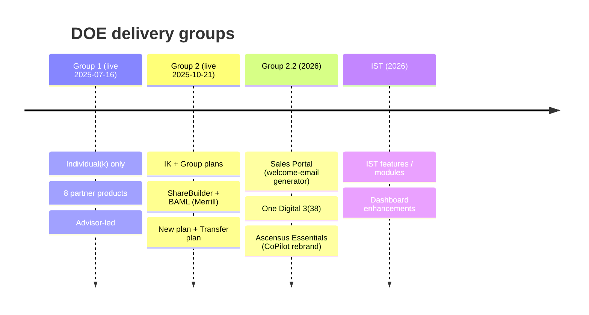
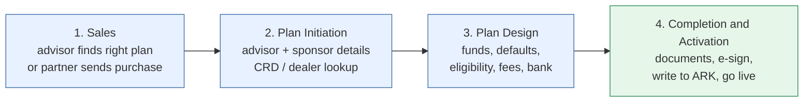

# 01 - What is the Digital Onboarding Experience (DOE)?

> Confidence tags used in this folder: **[Doc]** = stated on SharePoint, **[Seen]** = observed in the QA app on 2026-11-05, **[Guess]** = reverse-engineered best guess.

## One-paragraph summary

DOE is a **self-service web experience** that lets a financial **advisor** (and then the **plan sponsor / business owner**) set up a small-business **401(k)** (a Solo(k) / Individual(k) or a multi-participant Group plan) without paper or phone calls. It is built on **Unqork** (no-code) screens, backed by **Ascensus APIs (Team White)** that write the plan into the **recordkeeping system (ARK)**, generate plan documents (**PAS**), file them (**Cliff**), open a work item for operations (**Chorus**), and create CRM records (**Salesforce**). Goal **[Doc]**: cut NIGOs (Not In Good Order submissions) and the time it takes a plan to go live (target about 5 business days).

## Who does what

| Team | Role in DOE | Source |
| --- | --- | --- |
| **White** | Middle tier: Onboarding.Api, Sales.Api, saga/orchestration, Chorus/Cliff/Salesforce/DCA integrations | [Doc] Handoff document |
| **Archers** | ARK plan setup (Setup Plan API, steps 1-5), plan defaults | [Doc] |
| **Yellow Jackets** | DocuSign integration | [Doc] |
| **Qonnectors (Auxo)** | Unqork vendor build; handed off to Ravens Sep 2026 | [Doc] Qonnectors handoff page |
| **Ravens** | Support/enhancement for Group 1, 2, 2.2; fund changes, document generation, new partners (One Digital, ShareBuilder, BAML) | [Doc] Ravens home page |

## The four groups (release waves)

## The four logical stages of every onboarding [Doc]

## Partner / product matrix

| Group | Partner (UI label) | Offering key (URL `product=`) | Plan type | Notes |
| --- | --- | --- | --- | --- |
| 1 | Victory (Amundi) | `AmundiDailyIk` | Individual(k) | Victory Funds branding, "Include Amundi funds only" in early prototype |
| 1 | Ameriprise | `AmeripriseBalFwdIk` | Individual(k) | Balance Forward |
| 1 | Pershing (BNY) | `PershingBalFwdIk` | Individual(k) | Balance Forward |
| 1 | J.P. Morgan | `JPMorganBalFwdIk` | Individual(k) | Balance Forward; "Add Roth" requested for Q3 |
| 1 | Ascensus Balance Forward | `AscensusBalFwdIk` | Individual(k) | Direct Ascensus |
| 1 | Ascensus Daily Level Comp | `AscensusDailyLCIk` | Individual(k) | Needs Common Remitter Agreement for 5-day SLA |
| 1 | Ascensus Daily Fee Based | `AscensusDailyFBIk` | Individual(k) | "Direct Fee Based Individual(k)" |
| 1 | State Farm | `StateFarmDailyIk` | Individual(k) | Captive "Agent" model (no CRD number on landing) |
| 2 | BAML (Merrill Edge) | `BAMLDailyIKNoAdv`, `BAMLDailyGroup` | IK + Group | Entry from Merrill Edge site -> Onboarding Portal -> Unqork |
| 2 | ShareBuilder | `ShareBuilderDailyIKNoAdv`, `ShareBuilderDailyGroup` | IK + Group | Purchase happens on ShareBuilder site; QA simulator exists |
| 2.2 | Sales Portal | n/a | IK + Group | Internal tool to generate welcome emails per partner/installation type |

Plan products behind the scenes **[Doc]**: `ARKPlan4One` (P4O, Individual(k)) and `ARKPlan4Most` (P4M, Group).

## Where the code and docs live

- Product links (source of truth): [`DOE-Product-Links-source.md`](DOE-Product-Links-source.md)
- Team White technical pages: [`../../team-white/`](../../team-white/README.md)
- All Unqork material across SharePoint: [`../../unqork/`](../../unqork/README.md)
- Next: [02 QA links and partner matrix](02-qa-links-and-partner-matrix.md)
