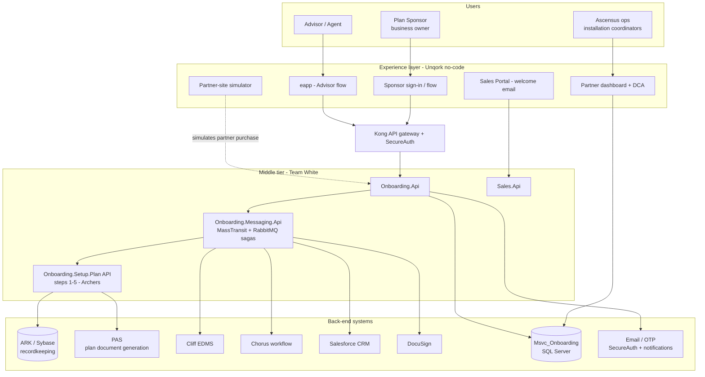
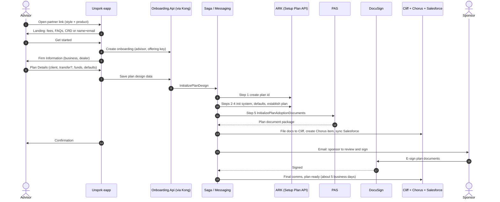
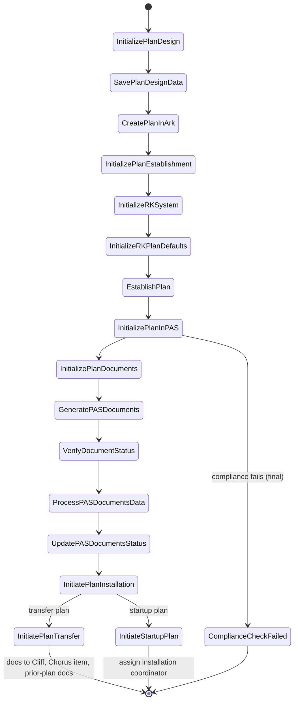
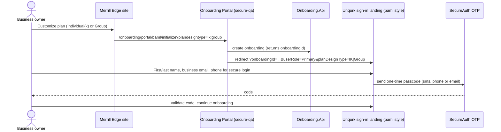
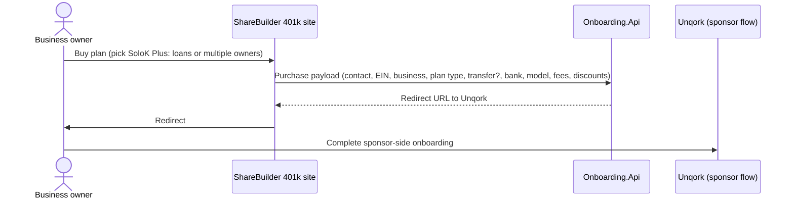
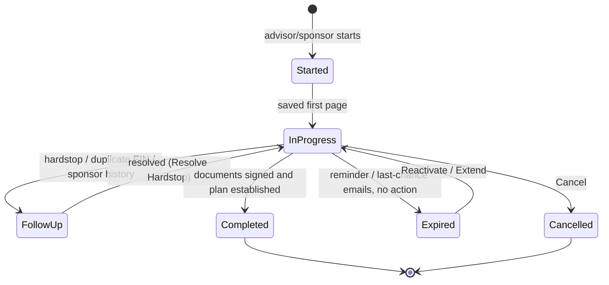
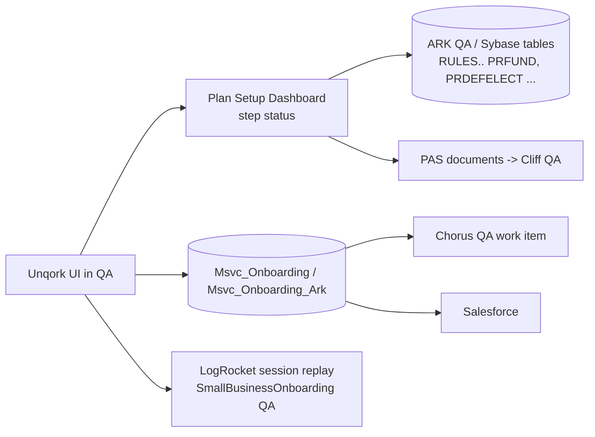

# 03 - Workflows and diagrams

Sources: Team White Architecture / Messaging Command Sagas / OTP / PAS pages **[Doc]**, plus what the QA app showed **[Seen]**. Items marked **[Guess]** are inferred.

## 1. System landscape

## 2. Group 1 advisor-to-live flow (Individual(k))

## 3. Saga states (Messaging Command Sagas) [Doc]

Every step has a `...Submitted` pending state and a `...Failed` state. `VerifyPlanDocumentsStatusTimedOut` is a distinct failure for slow PAS. Troubleshooting uses the **Plan Setup Dashboard** (`.../onboarding/setup/plan/PlanSetup/PlanCreationStatus` on DEV/QA/PRO hosts; QA only for us).

## 4. BAML (Merrill Edge) entry flow [Seen + Doc]

Endpoints **[Doc]**: `POST /security/{onboardingId}/otps` (send, 201) and `POST /security/{onboardingId}/otps/validate`; 400 for unknown onboarding id, missing OTP account, or blocked account.

## 5. ShareBuilder purchase flow [Seen simulator + Doc]

In QA, the **Purchase Site Simulator** (`/app/partner-site`) replaces the real ShareBuilder call.

## 6. Onboarding status model [Guess, from dashboard + issue titles]

Evidence: dashboard tabs "Follow up", "Individual(k)"; columns PLAN, START DATE, TIME, SPONSOR, DUPLICATE EIN; Team White release items for "Cancel/Extend/Reactivate", "Resolve Hardstop", "Sponsor History", "Expiration emails".

## 7. QA information flow (what to check where)

Next: [04 Page-by-page walkthrough](04-page-by-page-walkthrough.md)
