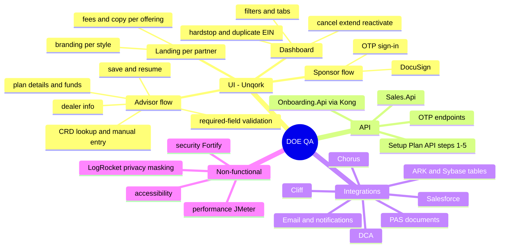

# 05 - Test strategy and coverage (starter plan)

## Existing assets you inherit [Doc]

| Asset | Where |
| --- | --- |
| Manual results (Group 1 QA, 2025-07-18, incl. Cliff + Chorus output per partner) | Test Results folder on Team White SharePoint (see Access page) |
| TFS test suites: Onboarding API (plan 647787), Workflow API (plan 658093), ARK integration (plan 656891) | [`04-testing-and-qa/Onboarding-Project-Access...`](../../team-white/04-testing-and-qa/Onboarding-Project-Access-and-Application-Testing-References.md) |
| Playwright UI: Group 1 ([DOE - PlayWright Testing](../../team-white/04-testing-and-qa/DOE---PlayWright-Testing.md)), Group 2 EndToEnd (`Onboarding.UI.DOE.Group2.EndToEnd` in repo `Onboarding`), `DCA.Partner.Dashboard.UI` tests (repo `DCA`) | TFS |
| API test strategy, performance (JMeter/Taurus, Rancher), test coverage | [`team-white/04-testing-and-qa/`](../../team-white/04-testing-and-qa/) |
| Archers QA notes, BAT feedback (Group 1 tests 2-4), DB verification pages | [`unqork/sharepoint-pages/TeamArchersSatellite/`](../../unqork/sharepoint-pages/TeamArchersSatellite/) |
| Session replay | LogRocket project `SmallBusinessOnboarding` (QA) - see [`../01-logrocket/`](../01-logrocket/README.md) |

## Coverage map (what to test, per layer)

## Partner x scenario matrix (tick as you cover)

| Scenario | Victory | Ameriprise | Pershing | JPM | Asc BalFwd | Asc DailyLC | Asc DailyFB | State Farm | BAML IK | BAML Grp | SB IK | SB Grp |
| --- | --- | --- | --- | --- | --- | --- | --- | --- | --- | --- | --- | --- |
| Landing copy + fees correct | seen | seen | seen | seen | seen | seen | seen | seen | seen | seen | | |
| Branding / logo correct | seen | seen | seen | seen | seen | seen | seen | seen | seen | seen | | |
| Advisor start (CRD) | | | | | | | | n/a | n/a | n/a | n/a | n/a |
| Manual advisor start | partial | | | | | | | | | | | |
| Plan details + funds | | | | | | | | | | | | |
| Transfer vs startup | | | | | | | | | | | | |
| Sponsor OTP + e-sign | | | | | | | | | | | | |
| ARK data check | | | | | | | | | | | | |
| PAS docs complete | | | | | | | | | | | | |
| Cliff + Chorus + Salesforce | | | | | | | | | | | | |

## High-value test ideas (from risks already found by Archers/White) [Doc]

1. **Dates**: Setup API accepts `yyyy-MM-dd` or `yyyy-MM-dd 00:00:00`; `...T00:00:00Z` shifts one day back; times are dropped. Test date formats and time zones from the UI.
2. **Defaults not overridden**: `PlanAgeRequirement` stays 21 and `PlanSvcRequirement` stays 12 for IK regardless of input.
3. **Boolean strictness**: `AutomaticFundingElection` must be `true/false`, not Yes/No; when true ARK also sets TradeSameDay and HoldAchUntilPayrollDate.
4. **Fund list edge cases**: duplicate funds -> unique funds closed; repeated EstablishPlan calls can leave 2 default funds at 100% each (total 200%) - UI must prevent.
5. **PAS mock behaviour** (`MockEndpointBehaviour`): 0 real, 1 forced success, 2 forced failure, other values -> failure; use it to test failure paths without real PAS.
6. **Offering-specific defaults**: BAML (directed trustee, Ascensus Trust Company) vs others (discretionary / custodian).
7. **Participants for fee-based IK plans**: a synthetic "ADMINISTRATIVE / FEE CREDIT ACCOUNT" participant must exist (AFAC2 for some groups).
8. **Hardstops / duplicate EIN / expiry**: reminder and "last chance" emails, extend and reactivate.
9. **LogRocket**: verify sensitive fields are sanitized in recordings (SSN, bank, EIN).

## Data to use
- Sample CRD in QA notes: `6249274` (lookup did **not** prefill in our run - see exploration log).
- Test bank account for ShareBuilder: `333555222`, routing any 9 digits.
- Use `@example.com` emails unless you want real notification emails.
- Do not use PRO links or real client data.

## Suggested first week for QA lead (you)
1. Request access tickets (Cliff QA, Chorus QA, ARK/Sybase QA, SQL `Msvc_Onboarding`, TeamCity/Octopus, TFS repos) - see Access page.
2. Re-run Group 1 landing checks for all 8 partners and capture baseline screenshots (done once here).
3. Walk one full advisor flow with Ravens/Aashay to confirm the dealer step and CRD lookup behaviour.
4. Pull the Playwright suites and run Group 1 locally.
5. Agree a quality KPI list with Emma/Aashay (defect leakage, regression pass rate, flow completion time via LogRocket).

Next: [06 Exploration log](06-exploration-log.md)
