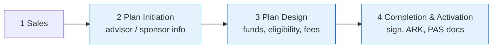

# DOE product documentation (Team Ravens)

Concept-level, diagram-first documentation of the **Digital Onboarding Experience**, built from SharePoint pages plus hands-on QA exploration (2026-11-05).

| # | Document | Use it for |
| - | --- | --- |
| 01 | [What is DOE](01-what-is-doe.md) | business concept, groups, stages |
| 02 | [QA links and partner matrix](02-qa-links-and-partner-matrix.md) | which URL = which partner/product |
| 03 | [Workflows and diagrams](03-workflows-and-diagrams.md) | landscape, sequences, saga states |
| 04 | [Page-by-page walkthrough](04-page-by-page-walkthrough.md) | screenshots and field lists |
| 05 | [Test strategy and coverage](05-test-strategy-and-coverage.md) | what to test, matrix, risks |
| 06 | [Exploration log](06-exploration-log.md) | findings, limitations, questions |
| - | [Product links (source)](DOE-Product-Links-source.md) | original page, credentials removed |
| - | [`ravens-site-docs/`](ravens-site-docs/) | Ravens site pages |

Deeper technical references (Team White): [`../../team-white/`](../../team-white/README.md). Unqork: [`../../unqork/`](../../unqork/README.md).

Coverage at a glance (QA only):
| Area | Status |
| --- | --- |
| Group 1 landing pages (8 partners) | explored (all 8 + preview + dashboard) |
| Group 1 advisor flow | partial (Firm Information, Dealer) |
| Group 2 BAML IK / Group | landing reached |
| Group 2 ShareBuilder simulator, Group 2.2 Sales Portal | form reviewed, not submitted |
| Sponsor flow, DocuSign, ARK/PAS verification | not explored (needs access) |
