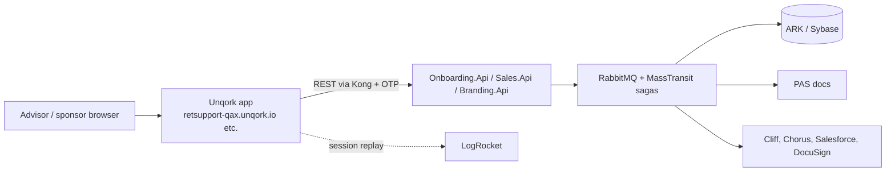

# Unqork at Ascensus Retirement

Unqork is the **no-code UI/workflow platform** used for the Digital Onboarding Experience (DOE). Business logic lives mostly in .NET services behind Kong; Unqork renders the screens and calls those APIs.

## Environments
| Env | Unqork tenant | Use |
| --- | --- | --- |
| DEV | `retsupport-devx` | developers |
| DEV2 | `retsupport-dev2x` | developers |
| QA | `retsupport-qax` | QA (what we explored) |
| PRO | `retsupport` | production - do not touch |

## People
- Unqork administrators: Franklin Zabala, Irina Stensky, Max Shakirov (see Registration List).
- Vendor: Qonnectors / Auxo (handed off to Team Ravens Sep 2026; PBI 855460).
- Details: [`../team-directory/`](../team-directory/README.md).

## Where the knowledge is (local copies)

| Topic | File |
| --- | --- |
| Unqork overview, access, environments | [`../team-white/05-unqork/Unqork-information.md`](../team-white/05-unqork/Unqork-information.md) |
| Registration list (who has access) | [`../team-white/05-unqork/Unqork-Registration-List.md`](../team-white/05-unqork/Unqork-Registration-List.md) |
| Unqork Academy (training) | [`../team-white/05-unqork/Unqork-Academy.md`](../team-white/05-unqork/Unqork-Academy.md) |
| Data dump / audit document | [`../team-white/05-unqork/Unqork-Data-Dump---Audit-Document.md`](../team-white/05-unqork/Unqork-Data-Dump---Audit-Document.md) |
| API test harness | [`../team-white/05-unqork/Onboarding-API-Test-Harness-(Unqork).md`](../team-white/05-unqork/Onboarding-API-Test-Harness-(Unqork).md) |
| Early onboarding notes (earlier work) | [`early-onboarding-notes.md`](early-onboarding-notes.md) |
| Unqork pages on other sites (Archers, DigitalOnboarding, retirement_devops, jcoladonCF, Team.Summit) | [`sharepoint-pages/`](sharepoint-pages/) |
| Everything on SharePoint that mentions Unqork (287 results, 36 sites, links) | [`sharepoint-unqork-index.md`](sharepoint-unqork-index.md) |
| DOE as a product (flows, partners, diagrams) | [`../team-ravens/02-doe-product/`](../team-ravens/02-doe-product/README.md) |

## Biggest sources by site
TeamWhiteCF (78), SoftwareDelivery (35), TeamArchersSatellite (33), DigitalOnboardingReadiness (29), TeamRavens (18), DigitalOnboarding (16), SatelliteCoreTeam (14). `DigitalOnboardingReadiness`, `SoftwareDelivery` and `SatelliteCoreTeam` are indexed only (not yet exported) - export them if you need depth.

## Why the earlier vendor effort failed (what the pages say vs what is guessed)
Not documented directly in SharePoint. Signals: vendor handoff (Qonnectors -> Ravens), Archers pages listing integration gaps (date formats, defaults, PAS failures), and a hard dependency on a handful of Unqork admins. Ask Aashay/Ema for the retrospective. **[Guess]**
